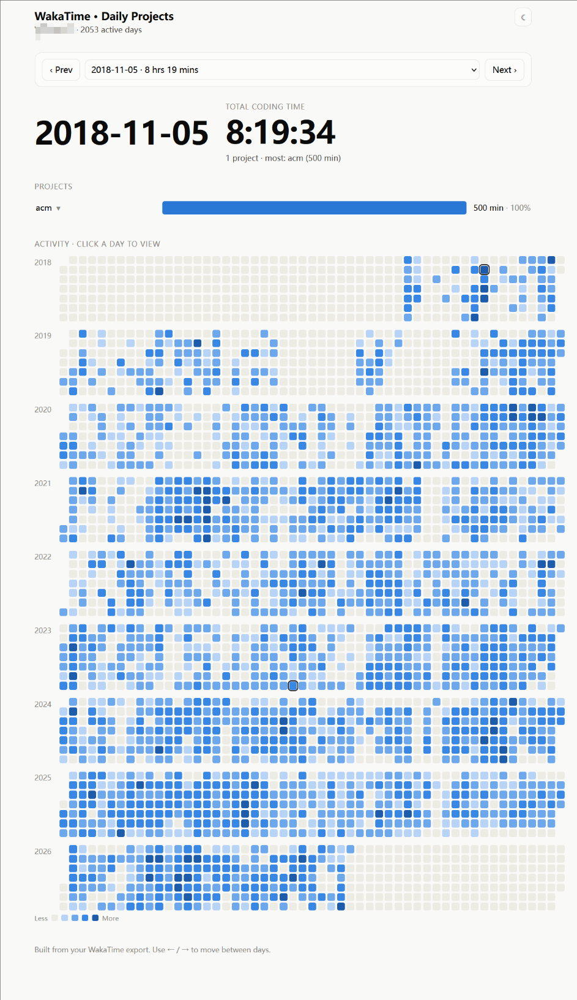

# waka-reader

A tiny static-HTML explorer for WakaTime data exports.

## What it does

`visualize.py` reads a WakaTime JSON export and emits a single self-contained
`visualize.html` file. Open it in any browser — no server, no CORS, no external
dependencies.

Features:

- Per-day project durations with a bar chart
- Drill-down into languages and editors per project
- Year activity heatmap (click a day to jump to it)
- Keyboard navigation (`←` / `→`)
- Light / dark theme toggle

## Setup

1. Export your data from WakaTime as JSON.
2. Place the file under `data/` named `YYYYMMDD.json`
   (e.g. `data/20260726.json`). The newest file is picked automatically.
3. Run:

   ```bash
   python visualize.py
   ```

4. Open `visualize.html`.

## Example



## Requirements

Python 3.7+, standard library only.
